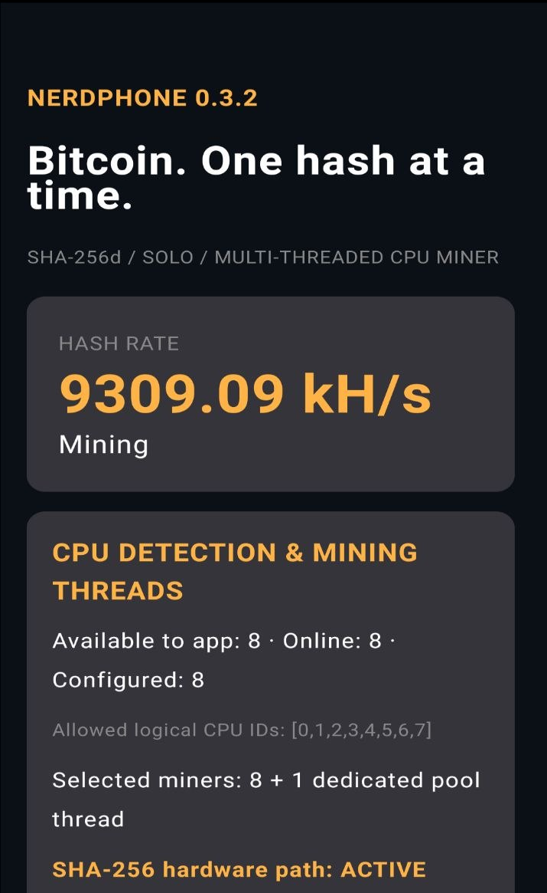
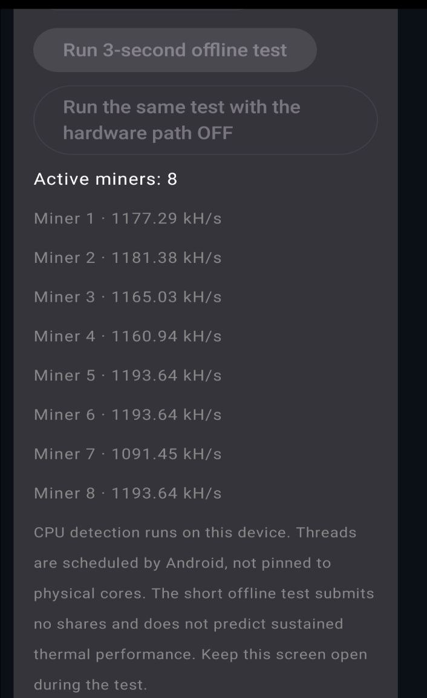
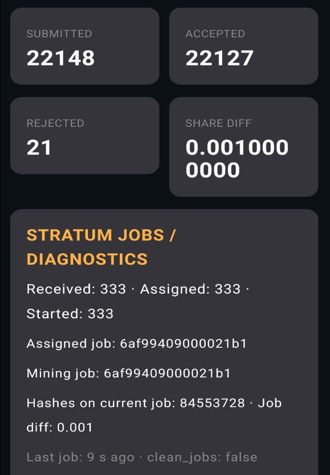
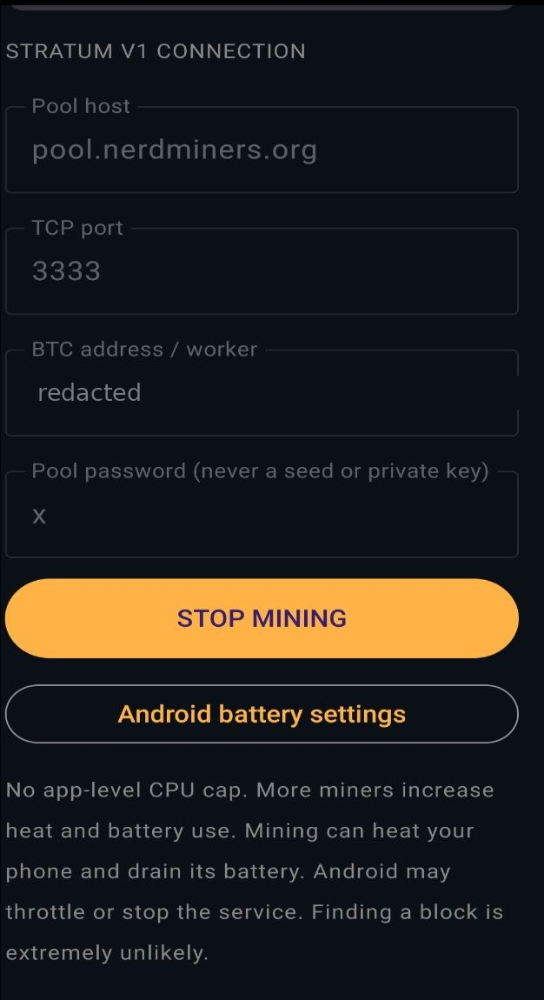
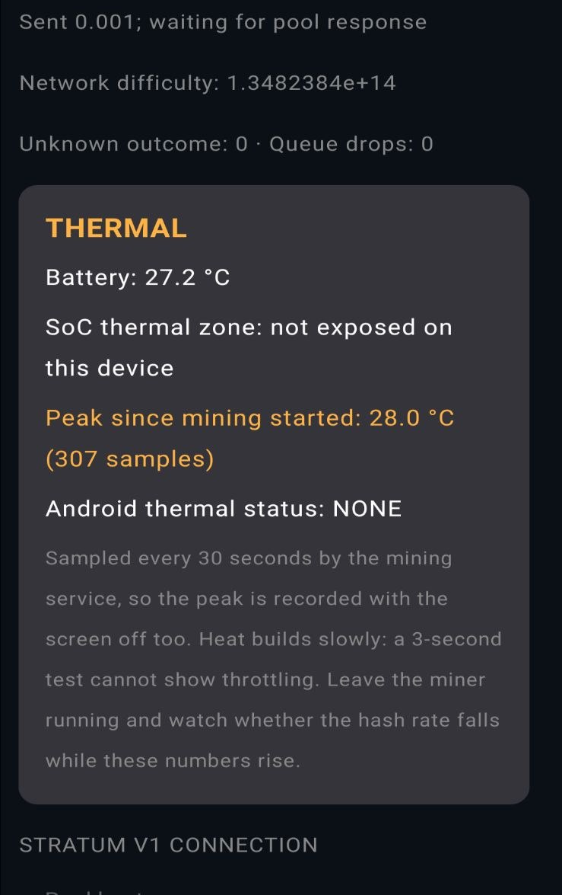
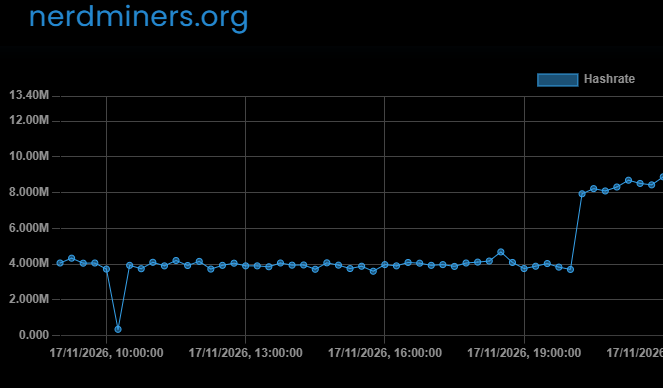

# NerdPhone


**Turn an old Android phone into an educational Bitcoin solo miner.**

NerdPhone is a native **C++ SHA-256d miner** with **Stratum V1 networking** and an **English Kotlin/Jetpack Compose interface**, running on the phone you already own. You choose how many mining workers to run, you can inspect the jobs your pool sends, and you can see shares actually accepted by the pool instead of trusting a local counter.

> **This is lottery mining, for learning.** It is not an investment and not a realistic source of income. On the tested device the expected time to find a block is measured in millions of years. Mining uses electricity and wears the battery. There is no yield, no return and no financial advice here.

**In a hurry?** The same build is available as a [signed APK for €5](https://xdrufox.gumroad.com/l/nerdphone); building from source is free.

## What it does

- **Configurable multi-threaded mining:** from one to every logical CPU currently available to the app, plus a separate thread dedicated to pool networking.
- **Per-device CPU detection** and a three-second offline hash-rate test that submits nothing to the pool.
- **Real share statistics:** submitted, accepted, rejected and unknown outcomes, with total and per-worker hash rates.
- **Live Stratum diagnostics:** jobs received/assigned/started, job IDs, hashes on the current job, difficulty, `clean_jobs` and message age.
- **Screen-off operation:** foreground service, persistent notification and partial wake lock, subject to Android and OEM background restrictions.
- **Block candidate detection:** the full header hash is compared against the network target, the alert is shown and the share is submitted. This is not a Bitcoin block confirmation.
- **No application-level CPU cap:** the selected workers hash continuously while valid work exists. Android thermal and power protection still applies.
- **ARMv8 SHA-256 instructions:** on 64-bit phones whose CPU exposes the SHA-2 unit, the 64 compression rounds run on `SHA256H` / `SHA256H2` instead of scalar code. The fast path is switched on only after it has reproduced the reference digest on 1,030 test hashes, and it switches itself off for the whole session at the first mismatch. It exists only in `arm64-v8a`; the 32-bit and x86 builds never emit those instructions.
- **Midstate optimisation** in the hashing hot path: the first SHA-256 compression state for each 80-byte header is computed once per job and reused for every nonce, so each nonce costs two compressions instead of three.

## Screenshots

Real captures from the **0.3.2** build, mining with eight workers and the hardware path active.
The Bitcoin address field has been redacted. Captures come from two sessions on the same device:
the morning session of 18 November (dashboard, workers, shares, connection, thermal) and the
overnight pool chart that contains both the software and the hardware path.

<p>
  
  
</p>

<p>
  
  
</p>

<p>
  
</p>

- **Dashboard:** 9,309.09 kH/s from the app's own counter, status *Mining*, eight cores configured,
  `Selected miners: 8 + 1 dedicated pool thread`, `SHA-256 hardware path: ACTIVE (self-test passed)`.
- **Workers:** eight miners from 1,091 to 1,194 kH/s each, about **9,357 kH/s** in total. The two
  buttons above the list are the three-second offline test and **the same test with the hardware
  path OFF**, which is the comparison this release was measured with.
- **Shares:** 22,148 submitted, 22,127 accepted, **21 rejected (0.095%)**; 333 Stratum jobs
  received, assigned and started; job difficulty 0.001.
- **Connection:** `pool.nerdminers.org` on TCP port 3333, pool password `x`, address redacted.
- **Thermal:** battery **27.2 °C**, peak **28.0 °C** over 307 samples, Android thermal status
  `NONE`, `Queue drops: 0`. This is a different session from the measurement table below, taken
  in a warmer room: the peak there is 25.9 °C. Both are real; they are not the same hour.
- **The SoC thermal zone is not readable on this device** and the card says so, instead of
  showing a number it does not have.

**Pool side, both paths in one chart:** the pool's own estimate for this worker over roughly
24 hours. It sits steady near **4 MH/s** through the day, then steps up to **8-9 MH/s** in the
evening of 17 November, when the hardware path was enabled. The brief drop near 11:00 is the
miner being stopped, not a fault. Major grid intervals are three hours.



> Pool-side estimates depend on share arrivals and smoothing windows. They are not a local
> benchmark — but this one is worth reading, because the step is visible and it was measured by
> somebody else's software.

## Measured on real hardware

Everything below was observed on one **repurposed UMIDIGI Power 3 running Android 10**, with **eight mining workers**, screen off, connected to `pool.nerdminers.org:3333` with pool-assigned difficulty **0.001**. It is a single device and a single operator's session: treat it as a field report, not a compatibility or performance certification.

| Observation | Result |
|---|---|
| Duration of the extended run | About **12 hours** screen off on the software-path build (0.2.4), with each pool graph division equal to **3 hours** |
| Pool-side hash rate over that run | Repeatedly near **4 MH/s** (`hashrate1hr` typically 3.9–4.0 MH/s in the supplied snapshots) |
| Shares | **56,952 accepted** of **56,999 submitted** in the captured session; counters carried over from 186 at the first snapshot, an interval-equivalent average near **4.0 MH/s** assuming one difficulty-0.001 share per increment |
| Rejections | **47**, all reported as `Stale` — about **0.08%**; no other rejection pattern observed |
| Best share | **74.5631** difficulty (raised from 40.51 earlier in the same session) |
| Perceived heating | **Cold to the touch** throughout; no fan or cooling accessory used |
| Internal temperature, power at the wall | **Not measured** |

The initial gap in the pool graph corresponds to a deliberate stop to install the update, not to a miner failure.

### Hardware SHA-256, measured on two phones

NerdPhone uses the ARMv8 SHA-2 instructions when the CPU exposes them. Both phones below ran eight workers:

| Device | Software path | Hardware path | Ratio |
|---|---|---|---|
| UMIDIGI Power 3 (Cortex-A53) | **4.14 MH/s** | **~9.4 MH/s** | **2.3x** |
| Oukitel T606 (Cortex-A75/A55) | not measured at 8 workers | 9 MH/s (app) | — |

The Power 3 row is the strongest evidence in this README, because both numbers are calculated from the **pool's own share counters, on the same worker and the same phone** — the app is not involved at all.

- **Before:** 9,780 shares in 10,140 s (17:32:17 -> 20:21:17 CET), i.e. 0.9645 shares/s.
- **After:** three windows, all agreeing:

  | Window | Duration | Shares | Rate | Ratio |
  |---|---|---|---|---|
  | 20:21:17 -> 20:32:20 | 663 s | 1,504 | 9.74 MH/s | 2.35x |
  | 20:37:19 -> 21:23:20 (after an app restart) | 2,761 s | 6,228 | 9.69 MH/s | 2.34x |
  | 20:21:17 -> 21:23:20 (gap included, conservative) | 3,723 s | 8,289 | 9.56 MH/s | 2.31x |

At difficulty 0.001, one share is 2^32 x 0.001 hashes. The Poisson uncertainty on the longest window is 1.1%, and at the old rate that window would have produced 3,590 shares instead of 8,289 — **78 standard deviations**. The improvement is not measurement noise.

**`hashrate1hr` is not a one-hour boxcar average.** If it were, then one hour after the change it should already read ~9.1 MH/s; at 21:23 it read 6.73. Its behaviour matches an exponential average with a time constant of roughly 90 minutes. That makes it useless for checking a prediction to two decimals, and no such check is claimed here. What it does show is the shape of the curve, and that shape is a monotonic rise with no plateau:

```
3.77  3.91  4.56  4.73  5.20  5.59  6.06  6.73     (one reading every few minutes)
```

A phone that was thermally throttling would plateau, and `hashrate1m` would sit systematically *below* `hashrate5m`. At 21:23 the pool reported `hashrate1m` 9.36 and `hashrate5m` 8.76, i.e. the fast window above the slow one and both above the hour.

`hashrate1d` needs a full day to move; at the time of writing it still reads 3.79.

Correctness is not taken on trust in either direction. The app compares 1,030 hardware hashes against the reference implementation every time it starts and falls back to the scalar path if a single one differs. On the Oukitel, **400 of 400 shares at difficulty 0.001 were accepted by the pool** — about 1.7 billion hashes checked by an independent party that would have rejected any wrong digest.

### Heat, with the hardware path on

Eight workers on the Power 3 with the ARMv8 path active, in a closed room at 21 °C: the
battery settled at **22.7 °C**, peaked at **25.9 °C**, and the cooling system is a plastic
case. The hash rate did not drift over the run — the fastest pool window stayed above the
five-minute window, which stayed above the hour. Details and caveats in
[validation](../docs/VALIDATION.md).

### The two hash-rate numbers, and why they differ

The app counts hashes computed on the device; the pool estimates work from the shares it receives. They answer different questions and will not match exactly.

| Number | Where it comes from | What it means |
|---|---|---|
| **~4,000 kH/s** in the app | Native worker counters, shown in kH/s | Local computation rate; short intervals can be quantised by counter batching |
| **~4 MH/s** on the pool | Pool estimate from accepted shares | Throughput the pool actually observed; smoothed and share-luck dependent |

Both are reported here so neither is mistaken for the other. A local counter alone does not prove valid submission, and a pool estimate alone does not prove the local loop is efficient.

### About 170 NerdMiner-class devices, in hash rate only

```text
4,140 kH/s ÷ 57 kH/s ≈ 73     (software path, 0.2.4)
9,600 kH/s ÷ 57 kH/s ≈ 168    (hardware path, 0.3.2)
```

The **57 kH/s** figure is the reference rate supplied by the tester; not every NerdMiner model or firmware version reaches it. Against a seller-declared **307 kH/s** device the same throughput would be roughly **31 devices** on the hardware path or **13** on the software path, assuming that advertised rate is actually achieved.

This is **arithmetic on hash rate**, nothing more: it is not a side-by-side hardware test and it says nothing about energy use, purchase cost or reliability. A phone running NerdPhone was also **cold to the touch with no fan or cooling accessory**, whereas some small miners are sold with fans that add their own consumption—but that too is an observation from one device, not a measured efficiency comparison. ASIC products with similar names belong to a different performance class entirely.

## Battery and heat

A separate unplugged run started at **90% at 10:13**, with eight workers and the screen off:

| Time | Battery | Elapsed |
|---|---|---|
| 10:13 | 90% | start |
| 10:32 | 87% | 19 min |
| ~10:46 | 85% | 33 min |
| 11:15 | 80% | 62 min |

That is about **10% of battery per hour**, roughly **9 hours 20 minutes projected from 90%**, while the pool continued to report around 4 MH/s. The phone was recharged after the measurement window ended, so later battery readings in the screenshots (67% at 14:35) belong to a different, post-charge session and are not part of these figures.

For an order-of-magnitude power estimate, assuming the nominal **5,000 mAh at 3.8 V (≈19 Wh)**:

```text
10% of 19 Wh = 1.9 Wh over 1.03 h  →  ≈1.8 W average for the whole phone
```

**Caveats, stated plainly:** the battery is a used cell, so its real capacity is likely below 5,000 mAh and this figure is **most likely an overestimate**; the percentage gauge is coarse; and this is the total phone consumption, not the miner alone and not a wall-plug measurement. The honest measured facts are the percentage drop and the reported lack of noticeable heating—not a certified wattage.

## Lottery mining, honestly

`pool.nerdminers.org` is a **solo** pool: every worker mines to its own address, so a block found by that worker pays the whole reward to that worker. It is not split among the pool's participants.

- Subsidy since the April 2024 halving: **3.125 BTC**, plus the transaction fees in the block.
- The pool dashboard showed **0 blocks found** with about **7.5 GH/s** of combined hobbyist hashrate.
- At the network difficulty current in November 2026, the expected time for a single ~4 MH/s phone is on the order of **billions of years**, and for the whole pool millions of years.

So: someone eventually wins the SuperEnalotto with a single ticket, and small solo miners have found blocks before. That is exactly the spirit here—a ticket that also teaches you how Bitcoin's proof of work, nonces, extranonce and share difficulty actually work. Do not buy this expecting to win.

## Install and start

**The source is free: build it yourself at no cost** ([build instructions](docs/BUILDING.md)).

> ### Ready-to-install signed APK — €5
> **[xdrufox.gumroad.com/l/nerdphone](https://xdrufox.gumroad.com/l/nerdphone)**
>
> One ZIP: the signed APK, the installation guide, the SHA-256 checksums and the licence. Optional — the source below stays free and MIT, and the purchase restricts none of your rights under that licence.

This repository and its CI **do not distribute APK/AAB artefacts**.

1. Install on **Android 8.0 / API 26 or newer** and allow notifications.
2. Enter your **public mainnet Bitcoin address**. Never a seed phrase, never a private key.
3. Default connection:

   | Setting | Default |
   |---|---|
   | Pool host | `pool.nerdminers.org` |
   | TCP port | `3333` |
   | Pool password | `x` |
   | Requested difficulty | `0.001` |

4. In **CPU DETECTION & MINING THREADS**, start with one or two miners. You can run the offline three-second test before connecting, and change the worker count with **+ / − / Use all** while stopped.
5. Tap **START MINING** and watch **ACCEPTED**, not the hash-rate animation.
6. For screen-off use, allow unrestricted battery/background operation in Android settings, and test on your own device before leaving it unattended.

`pool.nerdminers.org` is **not** `pool.nerdminer.io`; the two endpoints can assign different difficulties. The pool decides the assigned difficulty—requesting `0.001` does not force it.

## How to interpret the numbers

- **Local hash rate:** hashes computed by the native workers. Short intervals can be quantised by counter batching.
- **Pool hash rate:** an estimate derived from submitted work. It fluctuates with share luck and smoothing windows.
- **Jobs received:** protocol activity only—not proof that submissions are correct.
- **Accepted shares:** the pool accepted that work. They are not block confirmations and, on a solo pool, not periodic payments.
- **Best share:** the difficulty achieved by a share. Not the assigned difficulty, not the network difficulty, and not progress towards a block.

## Architecture

```text
Compose UI / Android main looper
           │ JNI configuration + telemetry
           ▼
   C++ mining workers × N ──► thread-safe share queue
           ▲                           │
           │ immutable jobs             ▼
           └──────── dedicated C++ Stratum worker ── TCP pool

Foreground service + partial wake lock manage background operation.
```

Workers search **disjoint nonce residue classes** for each job and `extranonce2`, so they never repeat each other's work. Threads are scheduled by Android and are not pinned to physical cores. The portable SHA implementation reuses the per-header midstate and fixed-size buffers in the nonce loop; it does **not** use ARM SHA instructions.

Correctness is checked offline by **20,480 header/nonce equivalence cases**, known-answer tests, an independent mock pool that validates submitted shares, and strict eight-hex-digit nonce formatting.

## Build and test

Requirements: **JDK 17**, Android SDK **35**, NDK **27.0.12077973**, CMake **3.22.1**. The Gradle Wrapper **8.9** is included with its distribution checksum.

```sh
./gradlew :app:assembleDebug
# APK: app/build/outputs/apk/debug/app-debug.apk
```

Offline host tests need Python 3 and a C++17 compiler:

```sh
bash tests/run_host_tests.sh
```

GitHub Actions runs the offline tests and compiles a debug APK only to verify that the build works. It uploads no binaries, publishes no releases and does not touch the production signing key. See [build instructions](docs/BUILDING.md), [signing procedure](docs/DISTRIBUTION-SIGNING.md) and the [release checklist](docs/RELEASING.md).

## Known limitations

- Plaintext TCP **Stratum V1** only: no TLS, no Stratum V2.
- No guarantee of uninterrupted background operation; Android and OEM power management can throttle or stop the service.
- No automatic restart after reboot or force-stop.
- No persisted block-candidate dossier and no automatic blockchain confirmation.
- Performance and stability vary by device; validation so far covers a single physical device.
- Battery behaviour depends on the age and health of the cell.
- No ARM SHA intrinsic acceleration; the heavy path is portable C++.

## Documentation and contributing

- [Technical guide](docs/TECHNICAL.md)
- [Build instructions](docs/BUILDING.md)
- [Field report](docs/benchmarks/first-device.md)
- [Screenshot guide](docs/SCREENSHOTS.md)
- [Roadmap](docs/ROADMAP.md)
- [Contributing](CONTRIBUTING.md) · [Security and safety](SECURITY.md)

When reporting a problem include the app version, device model, Android version, worker count and a sanitized error message. Never post seeds, private keys, signing keys or pool passwords. Bitcoin addresses are public but can link mining activity to your identity—redact them if you prefer.

## Attribution and licence

Inspired by and written against the Stratum flow of [NerdMiner_v2](https://github.com/BitMaker-hub/NerdMiner_v2), pinned at `e3a04b7d9f0b6e60ca6e02f7433c94d78d9dded4` (`V1.8.3`). NerdPhone is an independent Android implementation, not the original firmware and not a byte-for-byte copy. Not affiliated with NerdMiner, its developers or any pool operator.

**MIT licence**, with Bitmaker attribution preserved for reference material. Vendored nlohmann/json is MIT; the Gradle Wrapper is Apache-2.0. See [LICENSE](LICENSE) and the third-party notices in [reference/](reference/).
